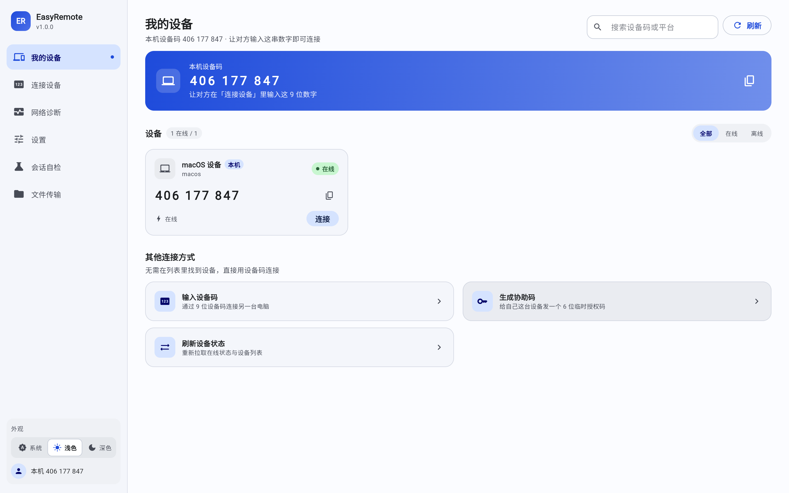
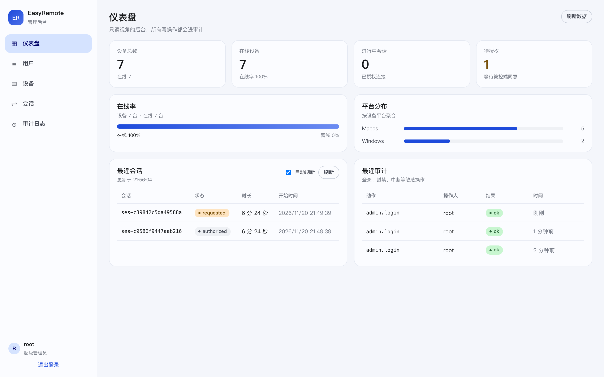

# EasyRemote

**低延迟、可自托管的跨平台远程桌面。** 服务端 Go，核心引擎 Rust，客户端 Flutter，运营后台 React。

[](https://github.com/ckkkf/EasyRemote/actions/workflows/ci.yml)
[](https://github.com/ckkkf/EasyRemote/actions/workflows/release.yml)
[](LICENSE)

[](server/)
[](core/)
[](client/)
[](web-admin/)



---

## 这是什么

EasyRemote 要解决的是远控行业的通病：**「连上就卡」，而且卡了没人说得清为什么。**

对标产品是网易 UU 远程（技术拆解见 [竞品分析](docs/research/uu-remote-analysis.md)）。功能对齐只是入场券，真正的产品主线是三条竞品普遍没做好的能力：

| | 能力 | 竞品现状 | 我们的做法 |
|---|---|---|---|
| **D1** | 网络诊断 | 只会说「网络不佳」 | STUN 探测 + 打洞结果 + 丢包时序汇总成**人话结论**：是不是我的问题、是不是对方的问题、该改什么 |
| **D2** | 防睡眠 | 普遍不做，远控中被控机睡过去直接断连 | 会话期间阻止系统睡眠，**断连即释放** |
| **D3** | 会话水印 | 多为本地叠加，客户端可去掉 | **被控端编码前叠加**，主控截图必带 |

## 架构

```
┌──────────────┐   WebTransport / HTTP3   ┌──────────────────────┐
│  Flutter     │◄────────────────────────►│  Rust 核心引擎        │
│  客户端 UI   │        FFI               │  transport / capture │
└──────────────┘                          │  codec / abr / input │
                                          └──────────┬───────────┘
┌──────────────┐                                     │ QUIC / UDP
│  React 运营  │──► Go 后台 API ──┐                  ▼
│  后台        │                 │        ┌──────────────────────┐
└──────────────┘                 ▼        │   中继 Relay（UDP）   │
                    ┌──────────────────┐  └──────────┬───────────┘
                    │  Go 网关 Gateway  │◄────────────┘
                    │  /v1/*  /admin/* │
                    └──────────────────┘
                      │            │
                 PostgreSQL     Redis
```

### 技术选型

| 层 | 选型 | 理由 |
|---|---|---|
| 传输 | **WebTransport over HTTP/3**（quinn） | 为 V2 浏览器主控铺路——浏览器只能经 HTTP/3 接入 |
| 采集 | Windows **DXGI Desktop Duplication** / macOS | 零拷贝帧路径 |
| 编码 | **NVENC** 硬编，OpenH264 软编兜底 | 已做同帧对比基准 |
| 自适应码率 | `er-abr` | 按丢包与时延动态调整 |
| 客户端 UI | Flutter 内置 **Material 3**，品牌色 `#1E4BDB` | 零第三方 UI 依赖，`ColorScheme.fromSeed` 自定品牌色 |
| 后台 UI | React 18 + Vite + Tailwind + shadcn/ui | 只与客户端共享色板与间距 |

## 仓库结构

| 目录 | 内容 | 规模 |
|---|---|---|
| [`server/`](server/) | 网关 `/v1/*`、运营后台 `/admin/v1/*`、rendezvous、UDP 中继、stack 聚合入口 | 179 个 Go 测试 |
| [`core/`](core/) | 11 个 Rust crate：`er-transport` `er-capture` `er-codec` `er-abr` `er-input` `er-session` `er-ffi` 等 | 170 个 Rust 测试 |
| [`client/`](client/) | Flutter 客户端（桌面 + Web + 移动） | Material 3 |
| [`web-admin/`](web-admin/) | React 运营控制台：仪表盘 / 用户 / 设备 / 会话 / 配置中心 / 审计 | 14 页 |
| [`docs/spec/`](docs/spec/) | **接口契约唯一来源**：`contract.yaml`（31 条路由）、错误码（100+ 条）、协议、页面清单 | — |
| [`docs/prd/`](docs/prd/) | 产品需求，v0.8 为现行版本 | — |
| [`scripts/`](scripts/) | 代码生成、质量闸门、跨机验证脚本 | — |



## 快速开始

### 服务端

```bash
cd server
go build ./...
go run ./cmd/stack -addr :18090   # 内存存储 + 信令，一键起整套服务
go test ./...
```

| 环境变量 | 说明 |
|---|---|
| `DATABASE_URL` | 设置后使用 PostgreSQL，否则内存存储 |
| `REDIS_URL` | 设置后使用 Redis（限流 / 中继注册 / 信令） |
| `ER_SECRET` | 生产必须设置；开发留空则生成临时密钥 |

### Rust 核心

```bash
cd core
cargo build --workspace
cargo test --workspace
```

### 客户端

```bash
cd client
flutter pub get
flutter run -d chrome --dart-define=ER_GATEWAY=http://127.0.0.1:8090
```

### 运营后台

```bash
cd web-admin
npm install
npm run dev
```

## API 概览

接口形状以 [`docs/spec/contract.yaml`](docs/spec/contract.yaml) 为唯一来源。改接口先改契约，再跑 `node scripts/gen-contract.mjs` 生成三端代码。

所有响应统一信封：

```jsonc
// 成功
{ "code": 0, "name": "OK", "data": { }, "trace_id": "..." }
// 失败
{ "code": 40101, "name": "AUTH_TOKEN_EXPIRED", "message": "...", "retryable": false, "trace_id": "..." }
```

| 分组 | 路由示例 |
|---|---|
| 鉴权 | `POST /v1/auth/sms` · `/v1/auth/login` · `/v1/auth/email/code` |
| 设备 | `GET /v1/devices` · `POST /v1/devices/bind` · `/v1/devices/identity` |
| 连接 | `POST /v1/connect/request` · `/connect/consent` · `/connect/status` · `/connect/keys` |
| 中继 | `POST /v1/relay/ticket` |
| 文件 | `GET/POST /v1/files` · `/v1/files/{id}/ticket` |
| 协助 | `POST /v1/assist/create` · `/assist/redeem` |
| 后台 | `/admin/v1/stats/overview` · `/users` · `/devices` · `/sessions` · `/config` · `/audit` |

## 开发约定

本项目对实现有强约束，详见 [AGENTS.md](AGENTS.md)：

- 响应只能由 `httpx.OK` / `httpx.OKPage` / `httpx.Err` 产出，禁止裸写 `map[string]any`
- 改接口先改 `contract.yaml`，跑 `node scripts/gen-contract.mjs`；生成物禁止手改
- 错误码只能从 `errcode` 选取，新增码先改 `docs/spec/error-codes.md`
- 字段一律 `snake_case`；`code` 这个键全站只归信封所有
- 每条路由必须有契约测试覆盖

提交前跑闸门（本地与 CI 同一套标准）：

```bash
bash scripts/gate.sh     # 9 步：gofmt / vet+test / tsc / 生成物 / 路由 / 禁止模式 / 版本 / 信封
```

### 分支模型

```
feat/xxx ──PR──► dev ──PR──► main ──tag vX.Y.Z──► Release
```

| 分支 | 说明 |
|---|---|
| `dev` | **默认分支**，日常开发都提交到这里 |
| `main` | 发布分支，受保护：必须 PR + 审查 + CI 绿才能合入 |

### 贡献流程

```bash
git switch dev && git pull
git switch -c feat/server-xxx           # 从 dev 切出
# ... 改动 ...
bash scripts/gate.sh                    # 必须 PASS
git commit -m "feat(server): 说明"      # 标题遵循 <type>(<scope>): <subject>
gh pr create --base dev                 # PR 合入 dev，CI 自动跑
```

发布：把 `dev` 合入 `main` 后打 Tag（`tag.yml` 校验 Tag 必须在 main 历史上）。完整流程见 [工作流说明](docs/github-workflows.md)。

## 文档

- [产品需求 PRD v0.8](docs/prd/easyremote-prd-v0.8.md)
- [接口契约](docs/spec/contract.yaml) ｜ [错误码](docs/spec/error-codes.md) ｜ [协议](docs/spec/protocol.md) ｜ [页面清单](docs/spec/pages.md)
- [竞品技术拆解](docs/research/uu-remote-analysis.md)
- [GitHub 工作流与发布规范](docs/github-workflows.md)
- [文档索引](docs/README.md)

## 路线图

| 期次 | 状态 |
|---|---|
| MVP | 网关鉴权、设备绑定、连接协商、Relay 中继、网络诊断、防睡眠 |
| V1 | 会话水印（被控端编码前叠加）、文件传输、会话自检 |
| V2 | 浏览器主控端（WebTransport）、1 人操作 + N 人只读观看 |

## 说明

- `docs/impl/` 保留各轮评审与真机验证证据，其中**主机地址、机器名已脱敏**为占位符（`<frp-host>` / `WIN-VERIFY-PC`）。
- 仓库内的手机号、验证码、演示账号均为测试数据，不对应任何真实账号。

## 许可证

[MIT](LICENSE) © ckkkf
